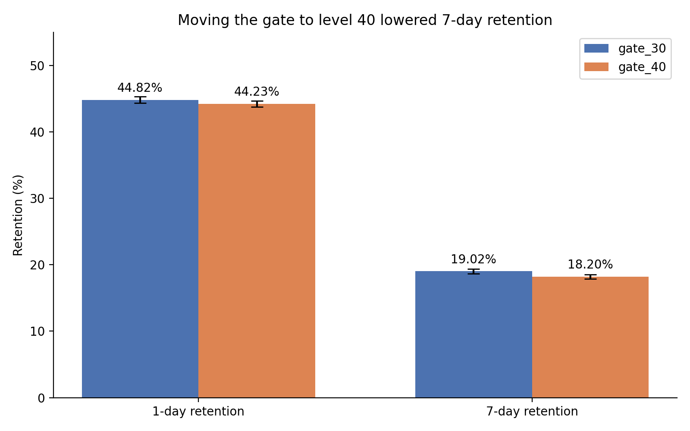
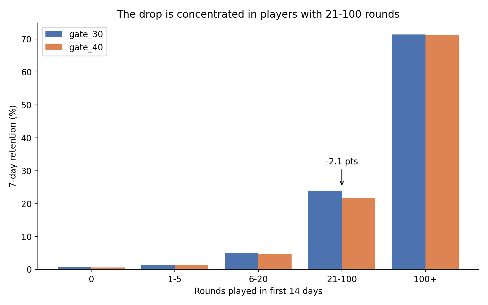
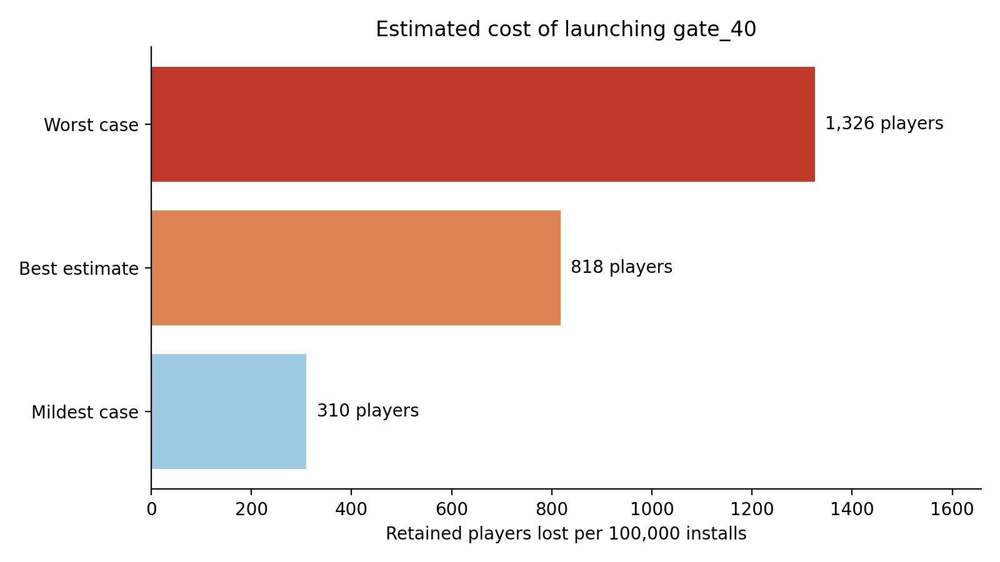

# Cookie Cats A/B Test: Should the First Gate Move from Level 30 to Level 40?

**Recommendation: keep the gate at level 30.** Moving it to level 40 lowered 7-day player retention and showed no benefit on any other measure.

This is an end-to-end A/B test case study: data checks, statistical testing with three methods, a business impact estimate, a one-page decision memo, and the project management documents that go with it (charter, RACI, risk register, timeline).

> The dataset is public (Kaggle) and no real company team was involved. Stakeholder roles in the project documents are illustrative, and the value per retained player (Rs 50) is an assumption, not a measured figure.

## The problem

In the mobile game Cookie Cats, players hit a "gate" that makes them wait or pay before continuing. An experiment moved the first gate from level 30 (control, `gate_30`) to level 40 (treatment, `gate_40`). Would this keep players engaged for longer?

- **Data:** 90,189 players (90,188 after removing one outlier)
- **Measures:** 1-day retention, 7-day retention, rounds played in the first 14 days

## Key results

| Measure | gate_30 | gate_40 | Difference | Result |
| --- | --- | --- | --- | --- |
| 7-day retention | 19.02% | 18.20% | -0.82 points (95% CI: -1.33 to -0.31) | Significant (p = 0.0016) |
| 1-day retention | 44.82% | 44.23% | -0.59 points | Not significant (p = 0.074) |
| Rounds played (median) | 17 | 16 | About 0 | No evidence of a difference (p = 0.051) |

- **Three methods agree on 7-day retention:** a two-proportion Z-test, a bootstrap (5,000 resamples, 95% range -1.31 to -0.32 points) and a Bayesian analysis (99.9% probability that gate_30 retains better).
- **It survives multiple-test correction:** adjusted p = 0.0048 after Bonferroni correction across the three main measures.
- **Where the drop is concentrated:** players with 21 to 100 rounds, where 7-day retention fell from 23.93% to 21.84% (about 2.1 points, adjusted p about 0.0002). This is exploratory, because rounds are measured after assignment.
- **Business impact (illustrative):** about 818 fewer retained players per 100,000 installs (range 310 to 1,326). At an assumed Rs 50 per retained player, roughly Rs 41,000.
- **Power:** the sample could detect a 7-day retention difference of about 0.74 points.







## Methods

1. **Data checks:** duplicates (none), group balance (sample ratio check flagged at p = 0.0086, but the size gap is only about 0.9 points)
2. **Outlier handling:** one player with 49,854 rounds removed; medians and a rank-based test used for rounds
3. **Retention:** two-proportion Z-test with 95% confidence intervals
4. **Bootstrap:** 5,000 resamples of the 7-day retention difference
5. **Rounds played:** Mann-Whitney U test, because the data is heavily skewed
6. **Multiple testing:** Bonferroni correction
7. **Player groups:** retention by rounds played (0, 1-5, 6-20, 21-100, 100+)
8. **Bayesian A/B test:** Beta-Binomial model, 100,000 simulations, expected loss
9. **Power analysis:** smallest detectable difference and sample size needed
10. **Business impact:** players lost per 100,000 installs, with a low and a high case

## Repository contents

```
cookie-cats-ab-test/
├── README.md
├── requirements.txt
├── cookie_cats_ab_test.ipynb
├── chart1_retention_comparison.png
├── chart2_segments.png
├── chart3_business_impact.png
├── Decision_Memo_Cookie_Cats_Gate_Test.pdf
├── Project_Charter_Cookie_Cats_Gate_Test.pdf
├── Stakeholder_Map_and_RACI_Cookie_Cats_Gate_Test.pdf
├── Risk_Register_Cookie_Cats_Gate_Test.pdf
└── Timeline_Cookie_Cats_Gate_Test.pdf
```

### Documents

| Document | What it is |
| --- | --- |
| [Decision memo](Decision_Memo_Cookie_Cats_Gate_Test.pdf) | One-page recommendation for non-technical readers, with the findings, risks and next steps |
| [Project charter](Project_Charter_Cookie_Cats_Gate_Test.pdf) | Purpose, objectives, scope, success criteria, deliverables and planned timeline |
| [Stakeholder map and RACI](Stakeholder_Map_and_RACI_Cookie_Cats_Gate_Test.pdf) | Who decides, who does the work, who is consulted or informed |
| [Risk register](Risk_Register_Cookie_Cats_Gate_Test.pdf) | Eight risks with probability, impact, mitigation, owner and status |
| [Timeline](Timeline_Cookie_Cats_Gate_Test.pdf) | Gantt chart of five phases and four milestones over five planned days |

## How to reproduce

1. Download the dataset from Kaggle: **Mobile Games A/B Testing - Cookie Cats** (`cookie_cats.csv`).
2. Open `cookie_cats_ab_test.ipynb` in Google Colab (or Jupyter). Colab: [Open the notebook](https://colab.research.google.com/github/palakgupta1512/cookie-cats-ab-test/blob/main/cookie_cats_ab_test.ipynb).
3. Upload `cookie_cats.csv` when the notebook asks for it, or place it in the same folder.
4. Install the libraries: `pip install -r requirements.txt`
5. Run all cells from top to bottom.

The dataset is not stored in this repository.

## Limitations

- Only 7 days of retention were measured, so long-term effects are unknown.
- There is no revenue data, so the business impact rests on an assumed value per retained player.
- Player-group findings use rounds played after assignment, so they show where to look next, not proof of cause.
- The rounds-played result is borderline (p = 0.051), so it shows no evidence of a difference, not proof of none.
- The group balance check was flagged, though the gap is small and three methods agree.

## Suggested next steps

1. Run a follow-up test that measures retention over 14 to 28 days and includes revenue.
2. Run a targeted test for players with 21 to 100 rounds.
3. Replace the assumed Rs 50 with the real value per retained player.

## Tools

Python (pandas, NumPy, SciPy, statsmodels, matplotlib), Google Colab

## About

Built by **Palak Gupta** as a data analytics portfolio project.
